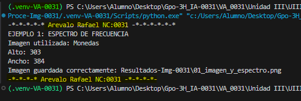
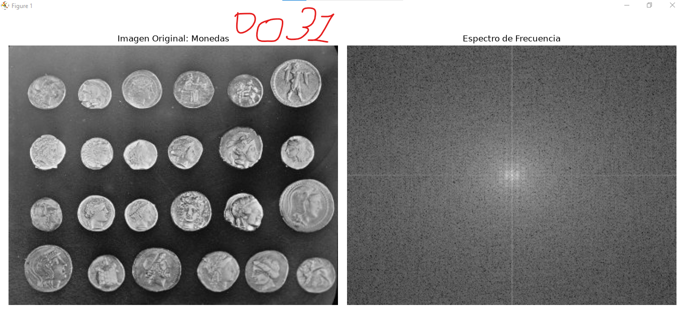
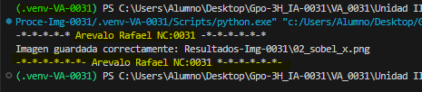
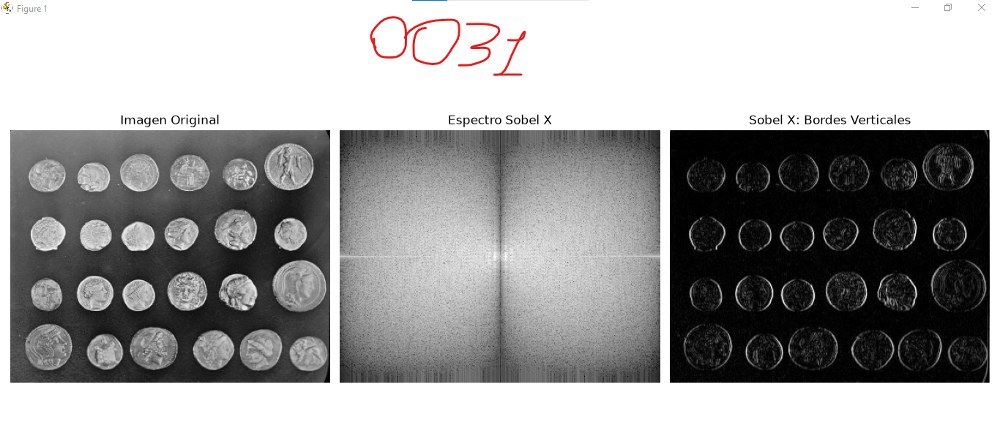
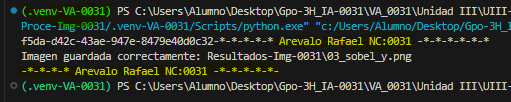
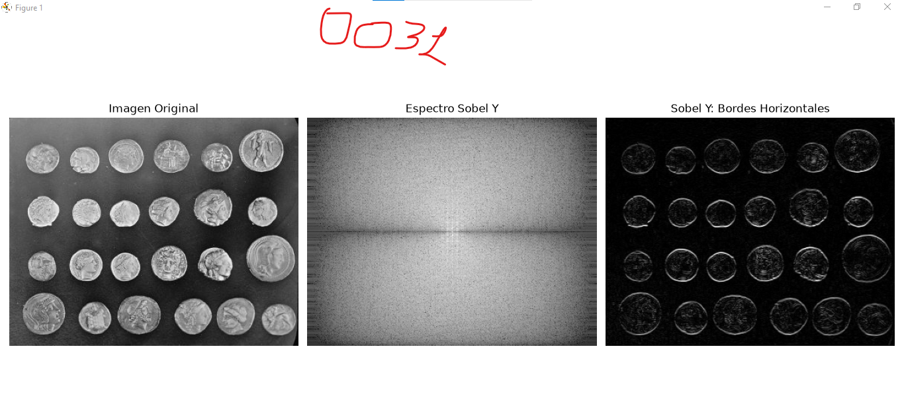
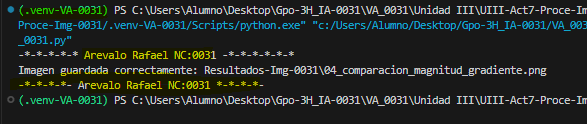
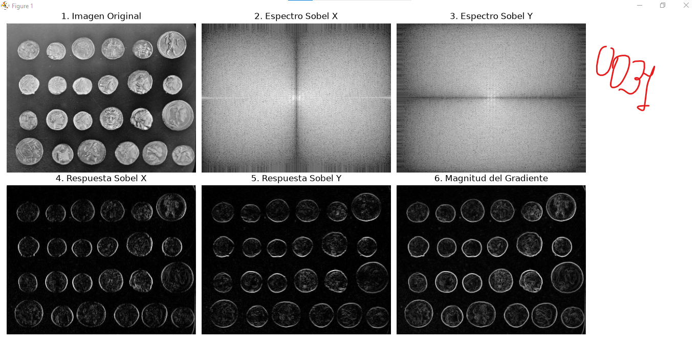

# PRACTICA 7: FILTROS SOBEL EN EL DOMINIO DE LA FRECUENCIA

**Alumno:** Arevalo Rafael  
**NC:** 0031

## EJEMPLO 1: IMAGEN ORIGINAL Y ESPECTRO Y RESULTADO EL CODIGO

## EJEMPLO 2: FILTRO SOBEL X Y RESULTADO EL CODIGO

## EJEMPLO 3: FILTRO SOBEL Y Y RESULTADO EL CODIGO

## EJEMPLO 4: MAGNITUD DEL GRADIENTE Y RESULTADO EL CODIGO

## 1. IMAGEN UTILIZADA
Por mi numero de lista 3 me corresponde utilizar la imagen de monedas de Scikit-image.

Funcion utilizada:

`data.coins()`

## 2. EVIDENCIAS

Las cuatro imagenes generadas se encuentran en la carpeta:

`resultados-img-0031`

